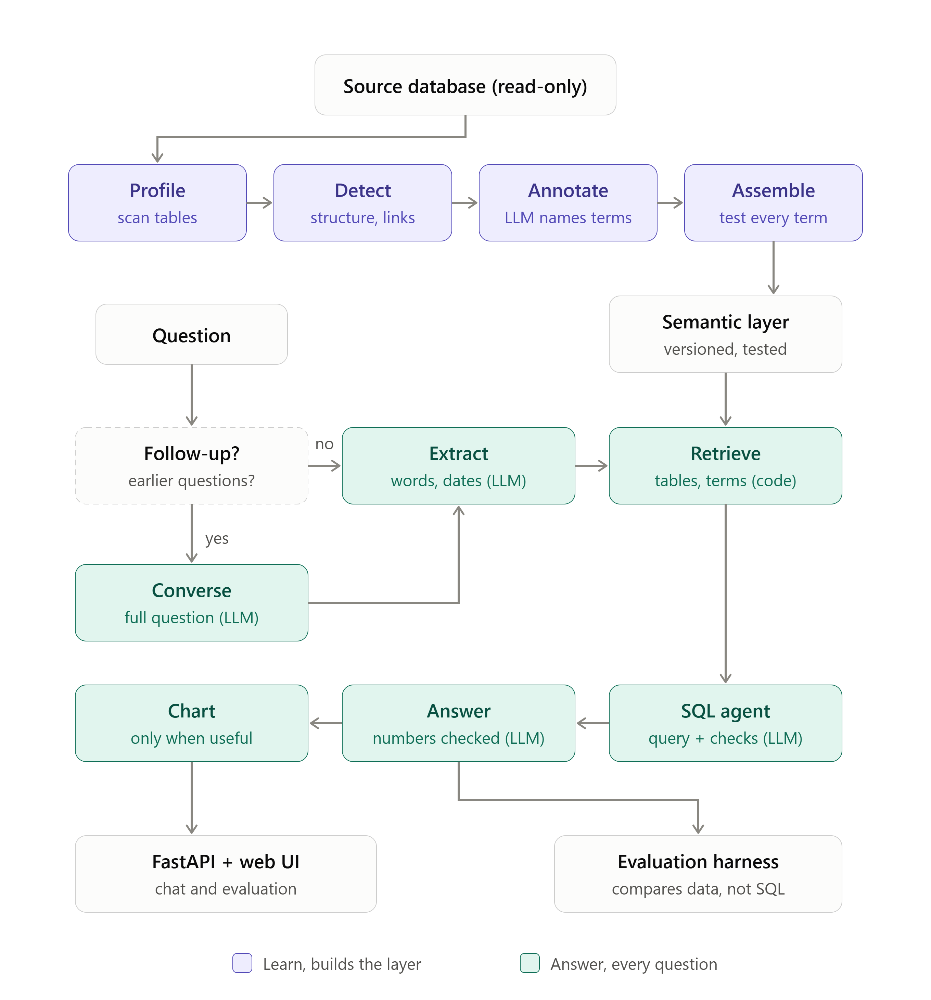

# Rosetta

Rosetta learns an unfamiliar database on its own and then answers business questions about it in plain words,
with the numbers, the query that produced them, and the evidence behind them.

The source is an Oracle 23ai database with two schemas and 21 tables, no declared keys and no data dictionary.
Rosetta is not told what any table or column means. It works that out from the data, writes it into a versioned
**semantic layer**, and answers every question from that layer.

**▶ Code walkthrough video:** [watch on Google Drive](https://drive.google.com/file/d/1iHnY4Z6xsCYxmRbXYzJy5qA2qC970ALt/view?usp=sharing)

## What it does

- **Learns the data (Checkpoint 1).** It profiles every table, detects history and snapshot tables, finds the
  "never ends" date, discovers joins by matching values, and lets an LLM name what it found. Every learned
  definition is then tested on the real data before it is published.
- **Finds the right data (Checkpoint 2).** For each question it picks the tables, columns, verified definitions,
  stored values and join patterns from the semantic layer, in plain code with no LLM.
- **Answers with evidence (Checkpoint 3).** An SQL agent writes and runs one read-only query. Code checks catch
  common mistakes before the query runs. The answer gives the figures, the query, what was counted and how dates
  were read, and it says so when the data cannot answer.
- **Proves it works (Checkpoint 4).** An evaluation harness asks the benchmark questions several times and compares
  the **data**, not the SQL. It reports how many answers were correct, consistent and fast, and explains every
  failure.
- **Converses (Checkpoint 5, follow-ups).** In the chat, a follow-up such as "now split that by city" or "what
  about March?" is understood from the earlier questions. It's rewritten into one complete question, and the SQL
  agent starts from the previous query.
- **Visualises the answer (Checkpoint 6).** When a chart tells the story better than a table, the chat shows an
  animated one. It picks between a line, side-by-side bars, a ranking or parts of a whole.

### Principles

- **Nothing is specific to this database or business.** No table, column, value or business word appears in code or
  prompts; a test (`tests/test_detect.py`) checks the code against every table and column name learned from the source. Everything Rosetta knows about this database
  lives in the learned semantic layer.
- **Engine independent.** All database access goes through a `SourceAdapter` (`rosetta/adapters/`). Oracle is the
  one implemented; another engine needs a new adapter, not changes elsewhere. SQL is parsed and checked with sqlglot
  in the adapter's dialect.
- **A wrong number is worse than no number.** Learned definitions are verified on the data, queries are checked
  before they run, every figure in the written answer must trace back to the result rows, and Rosetta refuses when
  the data cannot answer.
- **Repeatable.** The LLM runs at temperature 0 with a fixed seed and JSON-schema output. Learn results are cached
  and versioned, and the semantic layer gets a content hash as its version.
- **Read-only and private.** Rosetta only runs `SELECT`s. Values of columns that look like personal data (names,
  phone numbers, IDs) are never sent to the LLM or stored in the semantic layer.

## Architecture



In short: **Learn** turns the raw tables into a tested semantic layer. **Answer** turns each question into one
checked query and an explained result, using only that layer. The **API** serves it to the web UI, and the
**harness** runs the same pipeline on the benchmark.

```
rosetta/
  config.py          settings from .env (no secrets in code)
  storage.py         JSON files under data/, written atomically
  llm.py             Gemini client: JSON schema, temperature 0, cache, pacing, retries
  adapters/          SourceAdapter interface + Oracle (python-oracledb thin mode)
  learn/             profile.py, detect.py, annotate.py, assemble.py
  answer/            converse.py, extract.py, dates.py, retrieve.py, sql_agent.py, sqlcheck.py, answer.py, chart.py,
                     pipeline.py
  api/main.py        FastAPI endpoints
  evaluate.py        evaluation harness (CLI + used by the API)
semantic/            the published semantic layer (YAML), its changelog, and hand corrections
eval/                benchmark.yaml and results/ (one folder per evaluation)
ui/                  React + Vite web app (chat and evaluation)
tests/               Detect stage tests on a small SQLite database
```

## Learn: from raw tables to a semantic layer

Each stage stores its output under `data/` (git-ignored), so stages can be rerun on their own.

| Stage | What it does | LLM? |
|---|---|---|
| **Profile** | Reads the catalog, then scans each table once: row count, nulls, distinct values, min/max. It lists all values of short columns (≤200 distinct) and the top 20 otherwise. It flags personal-data columns by name pattern and masks them. A fingerprint skips unchanged tables on rerun. | No |
| **Detect** | Works out each column's shape (code, flag, date, number, text). It finds **snapshot tables** (one row per entity per day) and **history tables**: start and end dates, a "never ends" sentinel date, one open version per entity, no overlapping versions. It also finds **dated version** tables, small **lookup lists**, and **links between tables** by value containment, with names used only to break ties. It notes how many rows each key has, so joins don't double count. It builds ready-made "current" and "as of a date" SQL from the measured sentinel value. | No |
| **Annotate** | Gives the LLM an evidence pack per table (shapes, values, links, detected rules; never personal data). The LLM proposes descriptions, value meanings and business **terms**: filters, measures and dimensions written as SQL. It also marks test, dummy or internal records. Code validates every proposed SQL against the schema with sqlglot. | Yes |
| **Assemble** | Carries filters through links to the tables that use them. It **tests every term on the database**: a filter must match some rows but not all, and a count can't run over a history or snapshot table without its date rule. It finds columns that are other names for the same thing (values that pair one to one). It applies hand corrections from `semantic/overrides.yaml` (each needs a reason), then publishes a new layer version, `semantic/semantic_layer.yaml` and `semantic/CHANGELOG.md`. | No |

The current layer holds 21 tables, the links between them, and 156 verified terms; 2 more were held back because they
failed verification. When something learned is wrong, it is corrected in `semantic/overrides.yaml` instead of in
code. The correction is tested like any other term and listed in the changelog.

## Answer: from a question to evidence

`rosetta/answer/pipeline.py` runs these steps for every question, both in the API and in the harness.

0. **Converse (LLM, only in a conversation).** The chat sends the last 3 questions, each as the complete question
   that was answered, together with its query.
   - **New question or follow-up:** one Gemini call decides. A follow-up ("now split that by district", "what
     about Ankara?") is rewritten into **one complete question**: everything from the previous question is kept,
     and only the asked change is applied.
   - **Code checks the rewrite:** it may only use words the user already typed, plus small joining words like "by"
     and "and". If it adds anything else, Rosetta answers the two questions combined as written.
   - **The previous query goes to the SQL agent** as its starting point. The agent keeps the same definitions,
     filters, joins and dates, and changes only what the follow-up asks.
   - **Long chains work:** each turn is passed on as the complete question it was read as, so the context carries
     forward.
   - **The chat shows how a follow-up was read,** for example "Read as: How many active shops are there in Ankara,
     split by district?".
   - **Evaluation runs send no history,** so benchmark questions are answered exactly as before.
1. **Extract (LLM).** It copies phrases from the question into slots: subjects, conditions, values, measures,
   grouping, dates and output shape. Code drops anything not actually in the question. Dates are read **in code**
   (`dates.py`): "June 2025", "as of 28 August", "last month" become exact half-open ranges, with a plain-language
   reading such as "read as 1 Jun 2025 up to (not including) 1 Jul 2025".
2. **Retrieve (code only).** It scores tables, columns and terms against each phrase with BM25. Exact words beat
   abbreviations, and abbreviations beat stems. It also looks phrases up in stored values ("Istanbul" → `İSTANBUL`),
   connects the chosen tables along verified links, and adds history tables that relate two of them. For each table
   it packs the join patterns: now, as of a date, at the moment of each event, began in a period, latest snapshot.
   If nothing matches the question's subject, it refuses here.
3. **SQL agent (LLM with tools).** The agent writes the query in at most 6 steps. Its tools are `run_sql`,
   `get_column_values` and `search_knowledge`, or it can call `cannot_answer`. Before a query runs:
   - **Hard checks:** it must be a single `SELECT`, every table and column must exist, and values must be real.
   - **Firm check:** test or internal records are counted unless the question asks to remove them.
   - **Soft checks:** they send the query back once with the reason. Resending it unchanged means "intended".

   | Soft check | What it catches |
   |---|---|
   | history version rule | a history table read without "current" or "as of" |
   | value words | a question word that is a stored value but isn't filtered on |
   | counting level | counting events vs distinct entities |
   | "assigned in June" | versions that began in a period vs versions valid during it |
   | rankings | "which is highest" must return every group, ranked, with its figure |
   | other names | when grouping by a name, show its other names too |
   | exact meaning | "5G eligible" must use the eligibility column, not a 5G opt-in flag |
   | dropped categories | an inner join silently dropping records with no match |

   After the query runs, notes are added for rows a join left out and for test records the answer includes.
4. **Answer (LLM, then checked).** The LLM writes a short answer and explanation for a business reader. Code then
   checks **every number** in that text against the result: cells, totals, differences and percentages between two
   figures, and the question's own numbers. If any number can't be traced, code writes a plain fallback instead.
   Personal-data values are hidden from the LLM.
5. **Chart (code only).** From the result's shape (periods, labels, figures), `chart.py` suggests a chart or none:
   - a line for 4+ periods
   - side-by-side bars for 2–3 periods
   - a sorted ranking (the top 15 when there are more)
   - parts of a whole, with shares

   There's no chart for single numbers, plain lists, refusals or more than 50 rows.

Each response includes the answer, the explanation, the rows, the SQL, the definitions, rules and values used, how
dates were read, the notes, the chart, the model, the layer version and the time taken.

## Evaluation harness (Checkpoint 4)

```bash
.venv/Scripts/python -m rosetta.evaluate --runs 3      # all questions, 3 times each
.venv/Scripts/python -m rosetta.evaluate --runs 1 --only q3 q6
```

It can also be run from the **Evaluation** tab in the UI, for all questions or a single one.

- **Benchmark:** `eval/benchmark.yaml` holds the 6 official questions with their reference SQL, plus 2 questions
  the data cannot answer.
- **Expected answers** come from running each reference query at the start of every evaluation. The reference's
  `SYSDATE` is pinned to the same "today" Rosetta is given.
- **Every run asks the model afresh,** with cache reads turned off, through the same pipeline the chat uses.
- **The comparison is on data only.** Values are normalised (numbers to 4 decimals, dates as `YYYY-MM-DD`, text
  trimmed). Column names, column order and row order are ignored, and columns are paired by the values they hold.
- **Verdicts:**

  | Verdict | Meaning |
  |---|---|
  | `match` | same data |
  | `match_extra_columns` | correct, with extra columns |
  | `partial` | right rows, but a reference column isn't shown |
  | `mismatch` | different data |
  | `correct_refusal` | refused a question the data can't answer |
  | `wrong_refusal` | refused a question the data can answer |
  | `answered_unanswerable` | answered a question the data can't answer |
  | `failed` | no working query |
  | `error` | the run stopped with an error |

- **Explanation for every amber or red run,** worked out from the rows. It lines rows up on their labels, then lists
  missing or extra rows and the figures that differ, with patterns ("Rosetta's figure is lower on every differing
  row"; "the reference is a whole multiple of Rosetta's, a sign of double counting").
- **Metrics:**
  - correct runs
  - questions correct in every run
  - consistency (same data in every run)
  - queries that ran
  - refusals right or wrong
  - wrong answers
  - time per run (mean, median, p95, max)
  - model calls
- **Output, committed to the repo:** each evaluation is saved in `eval/results/<date-time>/`:
  - `runs.jsonl`: per question and run, the SQL, columns, rows, verdict, explanation, seconds, model calls, model
    and layer version
  - `expected.json`
  - `summary.json`
  - `summary.md`

### Results on the official questions

Latest full run (`eval/results/20261022-154223`):

| # | Question | Result |
|---|---|---|
| q1 | Active shops in Istanbul with number, district and manager | All 50 rows and every column asked for match. The reference also shows shop ID and name, so the strict verdict is `partial` |
| q2 | Phone campaigns available for sale, by device | `match` (Rosetta also shows the other names of each device) |
| q3 | Segment with the most unique customers assigned in June 2025 | `match` (all 7 segments ranked, MASS 963 first) |
| q4 | Monthly gross adds and disconnections, July → August 2026 | `match` (1,722 → 1,474 and 1,067 → 921, with the change) |
| q5 | Mobile base on 28 Aug 2026, physical SIM vs eSIM | `mismatch`, a known gap, see below |
| q6 | Disconnections per tariff at the moment of the event, Aug 2026 | `mismatch`: same tariffs, counts differ on 5 of them, see below |
| r1, r2 | Questions the data cannot answer | `correct_refusal` |

Consistency was 100% in the 3-run evaluations: the same question gave the same data every time.

**Q6: where the two results differ.**
- **The as-of join:** Rosetta and the reference pick the same tariff-history row for each event, the one whose
  validity window contains the event date. Both match the same 807 of August's 921 disconnections. The other 114
  have no tariff version valid at that moment, and both queries leave them out.
- **The same tariffs:** both return the same 33 tariffs, with the same counts for 28 of them.
- **The difference is in naming the tariff.** In the tariff list (`D_TARIFF`), 5 tariffs have 2 or 3 rows, one per
  version, all with the same name.
  - **The reference** joins that list on the tariff id alone, so each disconnection on those 5 tariffs appears once
    per version (937 in total).
  - **Rosetta** takes one version per tariff, so each disconnection appears once (807 in total).
  - For example, GençAvantaj 12GB shows 54 in the reference and 18 in Rosetta.
- **The harness reports this as a mismatch** against the reference, and its explanation lists the 5 tariffs and
  the pattern.

**Q5: known gap.** For "subscribers in the mobile base", retrieval prefers a usage table, whose columns name
subscribers, over the daily subscription snapshot and its status lookup. The usage table has no row for 28 August,
so the query returns nothing, and Rosetta says it found nothing rather than inventing a number. Fixing it means
improving how retrieval weighs the subject against a condition such as "base".

## API

`uvicorn rosetta.api.main:app --port 8000`

| Endpoint | Purpose |
|---|---|
| `GET /health` | liveness |
| `POST /learn` `{"stage": "profile" \| "detect" \| "annotate" \| "assemble"}` | run one Learn stage |
| `POST /questions` `{"question": "...", "reference_date": "YYYY-MM-DD"?, "history": [{"question", "sql"}]?}` | answer a question, or a follow-up to the earlier turns in `history`: answer, explanation, rows, SQL, evidence, chart, and the complete question it was read as |
| `POST /extract`, `/retrieve`, `/sql` | inspect one step of the answer pipeline |
| `POST /eval/run` `{"runs": 2, "only": ["q3"]?}` | start an evaluation in the background |
| `GET /eval/status`, `/eval/results`, `/eval/results/{id}`, `/eval/benchmark` | follow a run, read saved results |

## Web UI

React 18 + Vite, in `ui/`. It has two tabs:

- **Chat:**
  - a ChatGPT-style thread with the answer, the explanation and any notes
  - follow-ups use the earlier questions, with a "Read as" line showing the complete question
  - a chart when one helps, then the result table
  - "How was this calculated?": how dates were read, the definitions, rules and values used, and the query
- **Evaluation:**
  - the run controls (all questions or one, number of runs) with live progress
  - a scorecard grouped as correct, consistent and fast
  - every question with its verdicts and a one-line reason
  - per question: the explanation, the rows that differ, and Rosetta's query and rows next to the reference

## Setup

Requirements: Python 3.11+, Node 18+, a read-only login to the source database, and a Gemini API key.

```bash
python -m venv .venv
.venv/Scripts/pip install -r requirements.txt     # on macOS/Linux: .venv/bin/pip
cp .env.example .env                               # fill in the database login and GEMINI_API_KEY
```

Learn the database (stage by stage, through the API):

```bash
.venv/Scripts/python -m uvicorn rosetta.api.main:app --port 8000
curl -X POST localhost:8000/learn -H "Content-Type: application/json" -d '{"stage": "profile"}'
curl -X POST localhost:8000/learn -H "Content-Type: application/json" -d '{"stage": "detect"}'
curl -X POST localhost:8000/learn -H "Content-Type: application/json" -d '{"stage": "annotate"}'
curl -X POST localhost:8000/learn -H "Content-Type: application/json" -d '{"stage": "assemble"}'
```

Run the UI:

```bash
cd ui
npm install
npm run dev          # http://localhost:5173 ; VITE_API_URL points at the API (default http://localhost:8000)
```

Tests (Detect stage, on a small SQLite database):

```bash
.venv/Scripts/python -m pytest
```

### Settings (`.env`)

| Setting | Meaning |
|---|---|
| `SOURCE_DIALECT`, `ORACLE_HOST`, `ORACLE_PORT`, `ORACLE_SERVICE`, `ORACLE_USER`, `ORACLE_PASSWORD` | source database (read-only login) |
| `SOURCE_SCHEMAS` | comma-separated schemas to learn |
| `GEMINI_API_KEY`, `GEMINI_MODEL` | LLM (a fixed model version, not a `-latest` alias) |
| `REFERENCE_DATE` | "today" for relative dates; empty means the real today |
| `QUERY_TIMEOUT_SECONDS`, `QUERY_MAX_ROWS` | limits for every query |
| `DATA_DIR` | where learned artifacts are stored (git-ignored) |
| `CORS_ORIGINS` | browser addresses allowed to call the API |
| `EVAL_MASK_PERSONAL_DATA` | mask personal-data columns in saved evaluation results |

## Model

Google **Gemini 3.5 Flash Lite** (`gemini-3.5-flash-lite`), chosen for its free-tier limits (15 requests a
minute, 500 a day). It is called at temperature 0 with a fixed seed and JSON-schema output, and its requests are
paced to stay under the per-minute limit. A typical question costs 3–5 calls: extract, 1–3 agent steps, and the
answer text. A follow-up costs one more, to read it.

## Limitations and next steps

- **Q5 retrieval:** weigh a question's subject against conditions such as "base", so the snapshot table wins over a
  usage table.
- **Clarifying questions (the rest of Checkpoint 5):** not built yet. Follow-ups are done. The plan:
  - ask only on strong signals that code measures: "best" or "top" with no figure to rank by, or two verified
    definitions of the same word that give different rows
  - show the options as buttons, and handle the reply as a follow-up
  - switch it off in evaluation runs
- **Engines:** only the Oracle adapter exists. The adapter interface is small (quote, limit, date literals, type
  families, approximate distinct, error mapping), so others can be added.
